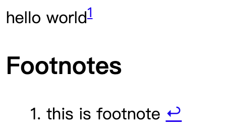

# remark-footnotes-extra

A remark plugin that converts inline `^[footnote content]` annotations into standard mdast footnote references and definitions.

## Install

```sh
npm install remark-footnotes-extra
```

Install `unified`, `remark-parse`, `remark-rehype`, and `rehype-stringify` for the rendering pipeline below. Add `remark-gfm` if you also need GFM syntax.

## Usage

```js
import remarkFootnotesExtra from 'remark-footnotes-extra'
import rehypeStringify from 'rehype-stringify'
import remarkParse from 'remark-parse'
import remarkRehype from 'remark-rehype'
import { unified } from 'unified'

const processor = unified()
	.use(remarkParse)
	.use(remarkFootnotesExtra)
	.use(remarkRehype)
	.use(rehypeStringify)

const file = await processor.process('hello world^[this is footnote]')
console.log(String(file))
```



Footnotes can contain text, emphasis, strong emphasis, links, images, and inline code:

```markdown
A citation^[Author, _Article title_, [source](https://example.com), accessed today.]

A note with brackets^[outer [inner] text] and another^[second note].
```

Identical content shares a definition. Different formatting or link destinations get separate definitions, even when their visible text is identical. Existing footnote identifiers are reserved, and an existing definition is reused only when its content matches.

## Options

### `breakLink`

Type: `boolean`. Default: `false`.

GFM literal autolinks can swallow the closing bracket and following text in `hello^[https://example.com]tail`. Enable `breakLink` to split that autolink at the closing footnote bracket:

```js
import remarkGfm from 'remark-gfm'

const processor = unified()
	.use(remarkParse)
	.use(remarkGfm)
	.use(remarkFootnotesExtra, { breakLink: true })
	.use(remarkRehype)
	.use(rehypeStringify)
```

Place this plugin after remark syntax plugins such as `remark-gfm`, and before `remark-rehype`. Explicit Markdown links keep their URLs intact.

## Parsing behavior

- Notes are collected within one inline container, such as a paragraph, heading, or table cell; they do not span separate paragraphs.
- Brackets in text are balanced, and surrounding text is preserved. Unclosed annotations remain unchanged.
- Code blocks and inline code are not scanned for annotations. Inline code can still be part of a note.
- Existing and generated footnote definitions are not scanned again. Nested `^[...]` inside a note remains literal content.
- This is an mdast transform, so other plugins must leave the annotation delimiters available in text nodes. It does not change the Markdown tokenizer or restore syntax already consumed by another parser.

## Development

The repository uses Bun workspaces and the committed lockfile:

```sh
bun install --frozen-lockfile
npm run typecheck
npm test
bun run --filter playground build
bun run dev
```

`npm test` builds and tests the published ESM and CommonJS entry points. `npm publish` runs type checks and the test suite before publishing.
